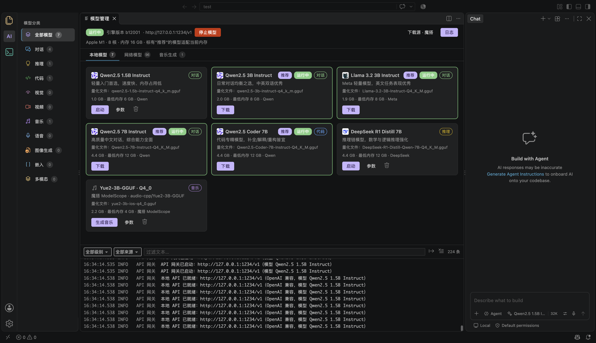
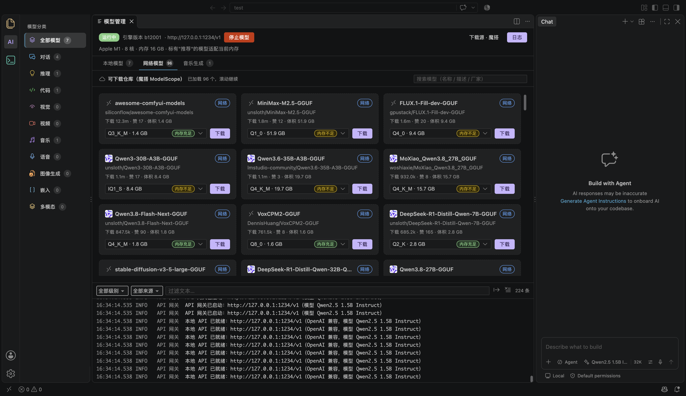
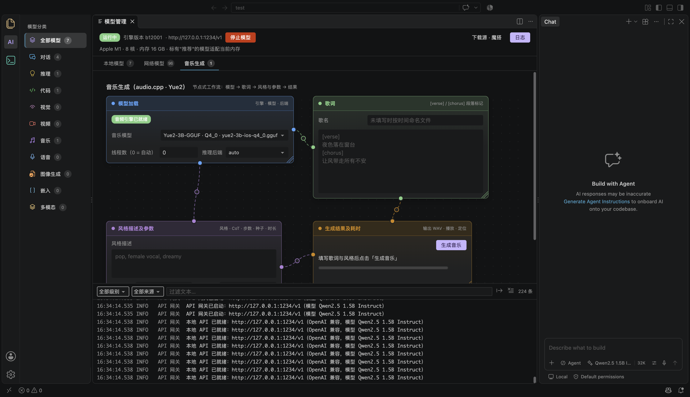

# iShell 简介

iShell 是基于 VS Code 打造的 AI 原生开发环境。除了继承 VS Code 的编辑、调试、扩展生态外，iShell 在左侧活动栏新增了两个入口：**AI（模型管理）** 与 **连接（终端/SSH）**，把本地大模型、模型下载和音乐生成都收进同一个工作台。

- 左侧活动栏：文件 → **AI**（紫色「AI」图标）→ 连接（终端图标）
- 模型管理以编辑器标签页形式提供三个界面：**本地模型**、**网络模型**、**音乐生成**
- 侧边栏按模型类别（对话 / 推理 / 代码 / 视觉 / 视频 / 音乐 / 语音 / 图像生成 / 嵌入 / 多模态）做彩色分类导航

## 本地模型

本地模型页展示内置的模型目录与已下载模型，卡片上直接给出可读的关键信息：

- 模型名与简介、标签（推荐 / 代码 / 推理）、量化文件名（如 `Qwen2.5-1.5B-Instruct-Q4_K_M.gguf`）
- 体积与资源需求（文件大小、最低内存 / 最低显存），以及来源仓库
- 每个模型提供 **启动 / 停止**、**下载**、**参数** 操作；已就绪的模型以绿色徽标标记
- 顶部状态条显示推理引擎版本、API 地址（`http://127.0.0.1:1234/v1`）与本机信息（如 `Apple M1 · 8 核 · 内存 16 GB`），并提示哪些模型适配当前硬件
- 底部「全部级别 / 全部来源」筛选与日志面板，实时输出 APP 接口、API 网关、模型加载等日志

## 网络模型

网络模型页用于从可下载仓库（默认「魔搭 / ModelScope」）浏览与下载模型：

- 已加载 96 个模型，滑动列表按需继续加载，顶部提示当前来源
- 标题右侧的搜索框支持按模型名、描述或厂商检索
- 卡片展示创建者、下载量、体积、支持的量化版本（`Q4_K_M` 等），可直接 **下载** 或 **下载至** 指定目录；下载完成后自动归入本地模型

## 音乐生成

音乐生成基于 audio.cpp / Yue2，采用「节点工作流」把生成过程拆成四步，每一步状态都能在界面上看到：

1. **模型加载**：选择音乐模型（如 `Yue2-3B-GGUF Q4_0`）、线程数与推理后端（auto / Metal / CUDA / CPU），并支持「重新加载」
2. **歌词**：按 `[verse]` / `[chorus]` 结构标签填写歌词
3. **风格描述及参数**：风格提示词（如 `pop, female vocal, dreamy`）、Cot 模式、时长等参数
4. **生成结果及耗时**：填写输出 WAV 路径后点击「生成音乐」，界面实时显示进度与阶段耗时，完成后可直接试听

## 连接管理

活动栏第三个入口「连接」使用终端图标，管理 SSH 主机列表与远程会话；选中主机即可在终端中建立连接，和模型工作区共用同一套界面布局。

## 典型使用路径

1. 打开左侧 **AI** 入口，在「本地模型」中挑选与硬件匹配的模型并点击 **启动**
2. 需要更多模型时切到「网络模型」，按关键词搜索并下载，下载完成后回到「本地模型」启动
3. 想生成音乐时切到「音乐生成」，按四步工作流填写歌词与风格，生成 WAV 并试听
4. 连接远程机器时切到「连接」，选择主机进入终端会话
